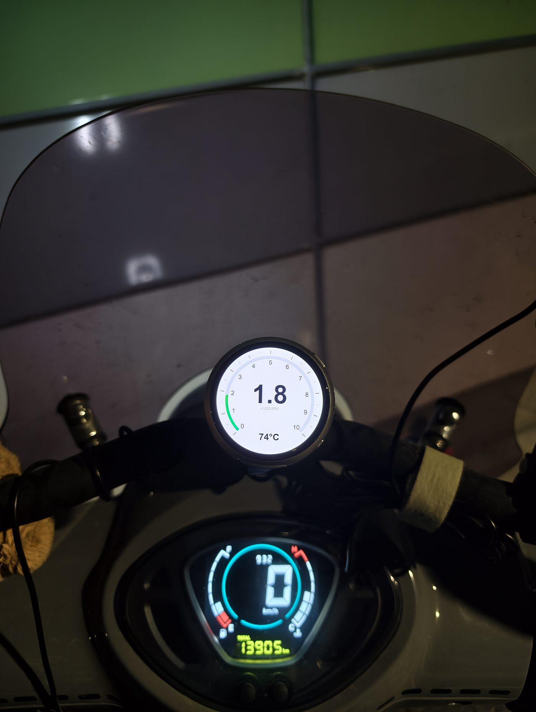
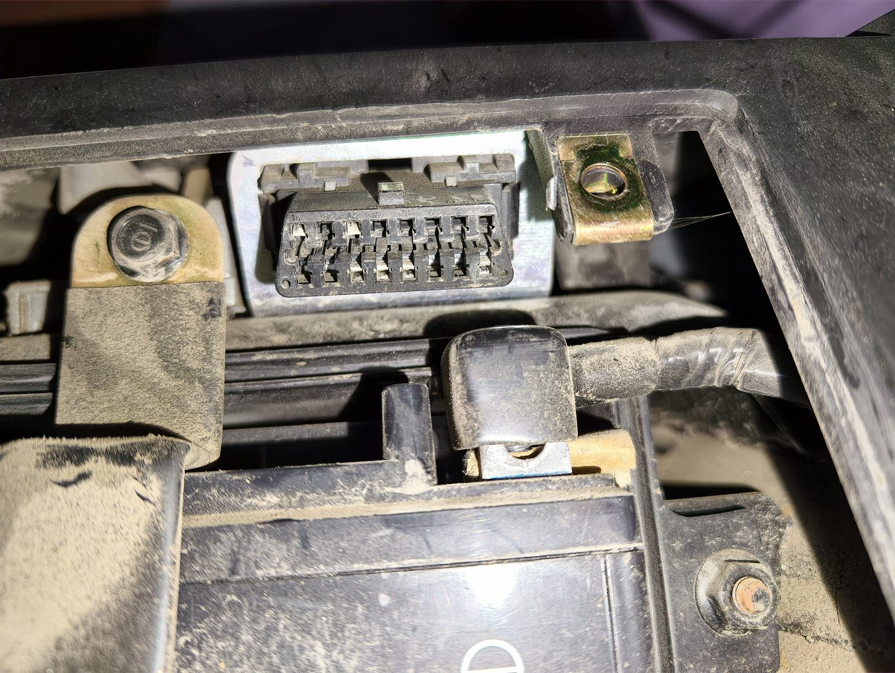
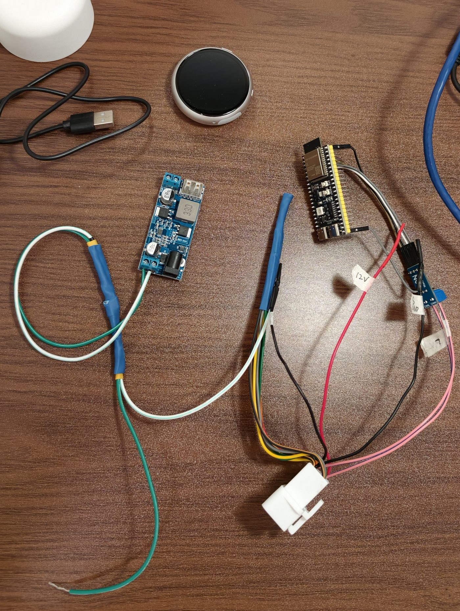
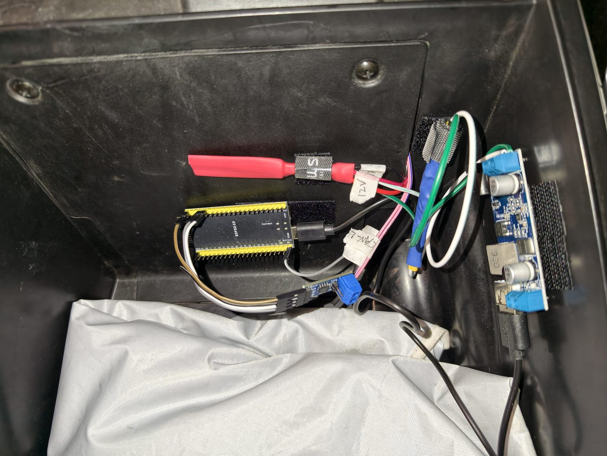
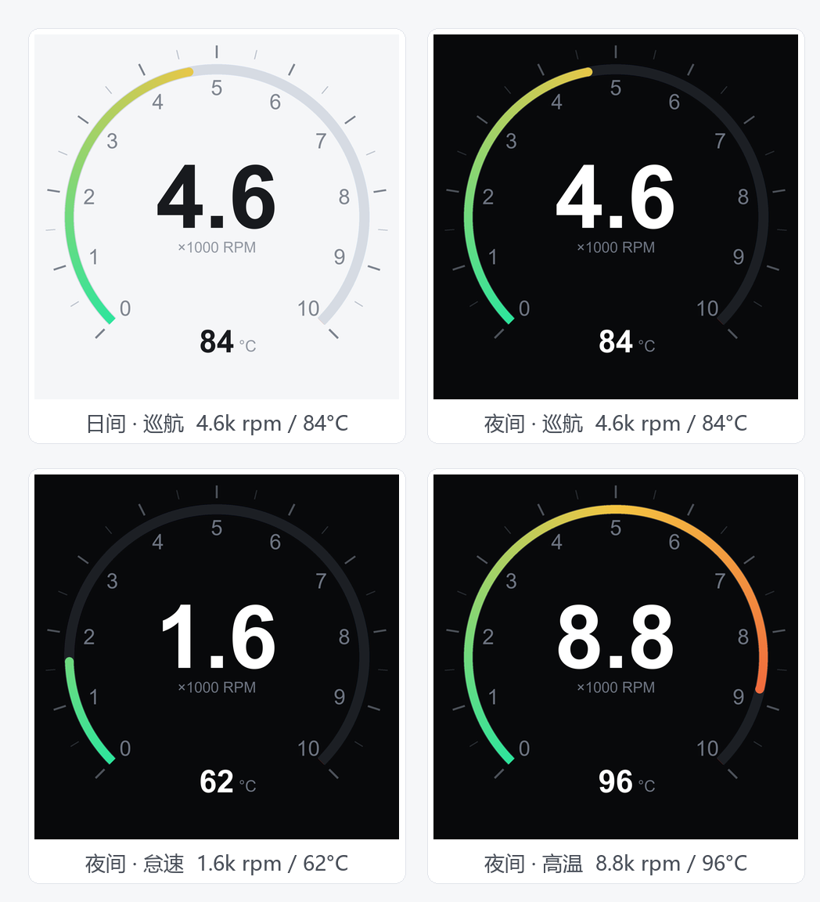
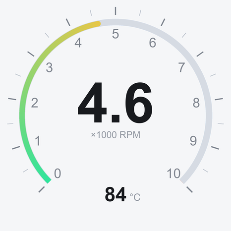
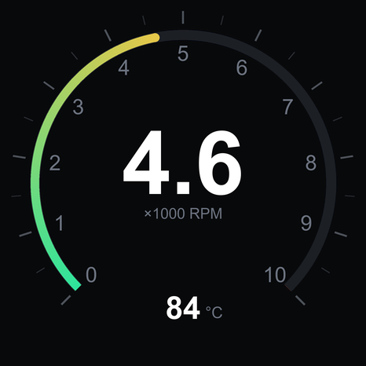
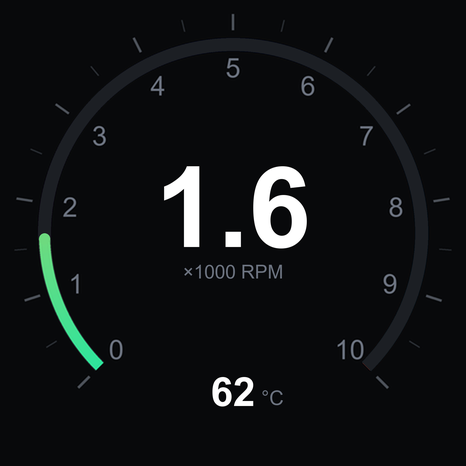
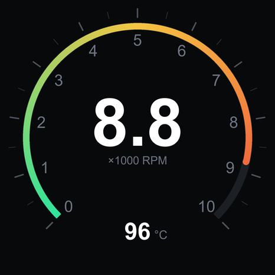

# OBD 圆屏仪表

> 给摩托车加一块圆屏电子仪表：从 OBD-II 读取 ECU 的转速与水温，经 ESP-NOW 无线投到车把上的 466×466 圆屏，实时显示。


<p align="center">
  
</p>

---

## 这是什么

一个摩托车 OBD 数据仪表系统，由两块 ESP32-S3 组成：

```
车载 OBD-II ──CAN 500k──>  发送端 ESP32-S3  ──ESP-NOW 2.4G──>  接收端圆屏
 (16 针标准口)   SN65HVD230   (读PID·20Hz广播)    <──心跳回传──    (466×466)
```

- **发送端**（座桶内）：通过 CAN 轮询 OBD PID，读取**发动机转速**与**冷却液温度**，解码后以 20Hz 广播。
- **接收端**（车把）：圆屏显示「转速弧 + 大数字 + 水温」，另含设置页与日/夜双主题。

实车已跑通：接入 OBD 后，圆屏显示与 ELM327 一致的转速、水温（2026-11-08，v0.2-beta）。

---

## 适用车型与兼容性

本项目基于 **SYM Fiddle 5（三阳飞度 5）** 实测开发，该车诊断口为 16 针 OBD-II，
协议为 **ISO 15765-4 CAN（11 bit，500 kbaud）**。

> ⚠️ **注意**：本项目的 CAN 链路**只针对飞度 5 的 CAN 协议验证过，未测试 K-Line**。
> 国四（Euro 4）车型的诊断协议并不统一——部分车型走 CAN，部分走 K-Line。
> 如果你的车是 **K-Line** 而非 CAN，物理层与协议栈需要**自行适配**：
> 本项目用的是 SN65HVD230 CAN 收发器，K-Line 需换成 L9637D 等 K 线收发器，
> 协议也要从 ISO 15765-4 换成 ISO 14230 / KWP2000。**接车前请先确认自己车的诊断协议。**

---

## 功能特性

| 功能 | 说明 |
|---|---|
| 🏍️ 转速显示 | 0–10000 rpm 转速弧（绿→黄→橙→红渐变）+ 中央大数字 |
| 🌡️ 水温显示 | 冷却液温度（°C）实时显示 |
| 🌗 双主题 | 日间 / 夜间一键切换 |
| ⚙️ 设置页 | 亮度滑条、主题切换、电量、发送端/CAN 状态、演示模式、版本号 |
| 📡 ESP-NOW | 单向数据 20Hz + 心跳回传，500ms 内判定在线/离线 |
| 💤 深度睡眠 | 总线静默 60s 入睡，5 分钟定时唤醒 |
| 🔍 诊断模式 | 分层排查 CAN 链路（RX 连通性 / TX 通路 / ACK / 速率监听） |
| 🎭 演示模式 | 按住 BOOT 键进入模拟数据，无车也能验证整条链路 |

---

## 硬件清单

| 部件 | 型号 / 规格 | 角色 |
|---|---|---|
| 发送端 | ESP32-S3 N16R8 开发板（16MB Flash / 8MB PSRAM） | CAN 采集 + 无线发送 |
| 接收端 | 微雪 ESP32-S3-Touch-AMOLED-1.75C（466×466，32MB Flash） | 圆屏显示 |
| CAN 收发器 | SN65HVD230 模块（**必须 3.3V 版**） | CAN 物理层 |
| OBD 接头 | 16 针公头带尾线 | 车载接口 |
| 供电 | 9–36V→5V 降压 + 保险丝 + SMBJ18A | 装车供电 |

> ⚠️ CAN 收发器只能接 3.3V，接 5V 会烧毁。完整接线表见 [`docs/sender-wiring.md`](src/docs/sender-wiring.md)。

---

## 硬件现状与后续方向

**先把现状说清楚**：发送端的硬件集成度还很低 —— 供电模块、开发板、CAN 收发器
目前是靠**杜邦线手工连接**的，属于「原型验证」形态，**还不适合直接装车长期使用**。

这个项目真正的价值，在于把下面这条链路**从零到一真实落地跑通了**：

```
ACC 取电 ──> 降压到 5V/3.3V ──> ESP32-S3 + CAN 收发器 ──> OBD 取 CAN 信号 ──> 解码转速/水温
```

也就是说，**「ACC 取电、OBD 取 CAN 信号、ESP32 + CAN 收发器收发 CAN」这一整套流程，
已经在真实车辆上验证通过**。剩下的主要是工程化与产品化的工作。

### 后续可做的优化（欢迎贡献）

- **发送端集成到一张 PCB**：把降压、ESP32、CAN 收发器、接线端子整合到单板上，
  去掉杜邦线，解决抗振、防水、可靠性问题。
- **硬件选型兼顾成本**：发送端只做「CAN 采集 + 无线转发」，**不必非用 ESP32-S3** ——
  像 **ESP32-C3 Mini** 这类更轻量、更便宜的芯片就能胜任，可显著压低 BOM 成本。
- 接收端的圆屏 / 触摸方案也可按需替换，核心在于无线链路与数据契约（`telemetry.h`）保持兼容。

**如果你懂硬件、PCB 设计或降成本选型，欢迎接手集成工作** —— 直接提 Issue / PR 即可。
数据契约与协议细节见 [`docs/dev-guide.md`](src/docs/dev-guide.md) 第 5 节。

---

## 可扩展性

虽然本项目是给飞度 5 定制的，但架构上是**通用的 OBD 数据采集 + 无线显示**，扩展空间很大：

- **不止摩托车，汽车也能用**：OBD-II 是一套标准化体系，乘用车同样走 OBD-II（多为 500k CAN），
  这套「CAN 收发 → ISO-TP → PID 解析 → 无线投屏」的链路在汽车上同样适用，
  只需按目标车型确认波特率与物理接线（K-Line 车则需换收发器，见上文「适用车型与兼容性」）。
- **数据不止转速和水温**：转速（PID `0x0C`）与水温（PID `0x05`）只是当前展示的两个。
  OBD 还有大量标准 PID——**只要知道对应 PID，就能读到**车速（`0x0D`）、节气门开度（`0x11`）、
  进气温度（`0x0F`）、燃油压力等，改一下 `firmware/sender/main/decode.c` 的轮询与解析即可。
- **圆屏界面可升级**：接收端界面（`firmware/receiver`）可按「想显示的数据数量与类型」进一步扩展——
  加数据卡片、加第二块表盘、改多页轮播都行；核心是把 `telemetry.h` 的数据契约扩一扩，
  其余复用现有的 ESP-NOW + LVGL 渲染链路。

---

## 实拍照片

| OBD 诊断接口（座桶内） | 硬件原型（发送端 + CAN 收发器） |
|---|---|
|  |  |

| 装车 · 座桶内发送端 | 装车 · 车把圆屏显示真实数据 |
|---|---|
|  |  |

---

## 页面展示

圆屏仪表在不同状态下的实际画面（由固件同源素材烘焙渲染，与真机显示一致）：

<p align="center">
  
</p>

| 日间 · 巡航 | 夜间 · 巡航 | 夜间 · 怠速 | 夜间 · 高温 |
|---|---|---|---|
|  |  |  |  |

更多状态图见 [`docs/images/`](src/docs/images/)。

---

## 快速开始

### 环境

- **Windows** + ESP-IDF **v5.x**（本项目在 v5.5.5 上实测通过）
- Python 3（脚本依赖 `pillow` + `numpy`）

### 出包（最常用）

```bash
cd src
./tools/win/pack_firmware.sh receiver   # 只出圆屏
./tools/win/pack_firmware.sh sender     # 只出发送端
./tools/win/pack_firmware.sh            # 两端都出
```

产物输出到 `firmware_out/`，`*_full.bin` 从 **0x0** 烧录。

### 烧录参数（两端不同，不可混用）

| | Flash | 模式 | 频率 |
|---|---|---|---|
| 接收端 | **32MB** | DIO | 80MHz |
| 发送端 | **16MB** | DIO | 80MHz |

> 详细的构建 / 出包 / 烧录 / 版本号机制见 [`docs/dev-guide.md`](src/docs/dev-guide.md)。

---

## 文档导航

| 文档 | 说明 |
|---|---|
| [`docs/requirements.md`](src/docs/requirements.md) | 📋 **需求文档**（功能/非功能/硬件/界面需求 + 验收标准） |
| [`docs/dev-guide.md`](src/docs/dev-guide.md) | 🛠️ **开发文档**（架构、构建、约定、坑清单、速查） |
| [`docs/power-plan.md`](src/docs/power-plan.md) | 🔌 装车供电方案 |
| [`docs/sender-wiring.md`](src/docs/sender-wiring.md) | 🔧 接线表与联调指南 |
| [`docs/可行性分析报告.html`](src/docs/可行性分析报告.html) | 🔬 技术可行性论证 |
| [`docs/UI规格-beta.html`](src/docs/UI规格-beta.html) | 🎨 界面规格锁定表 |
| [`CHANGELOG.md`](src/CHANGELOG.md) | 📝 版本变更记录 |

---

## 目录结构

```
src/
├── CHANGELOG.md               版本记录
├── docs/                      文档（需求 / 开发 / 供电 / 接线 / 界面）
│   └── images/                界面渲染图 + 实拍照片
├── firmware/
│   ├── common_components/shared/   telemetry.h（23 字节数据契约）、heartbeat.h
│   ├── sender/                发送端（ESP-IDF：CAN / ISO-TP / OBD / ESP-NOW）
│   └── receiver/              接收端（ESP-IDF + LVGL：圆屏界面）
└── tools/
    ├── gauge_art_v2.py        渲染仪表背景图
    ├── png2c.py               位图 → LVGL RGB565 C 数组
    ├── gen_fonts.sh           中文字体子集
    └── win/                   ★ 构建/出包/抓串口脚本（Windows）
```

---

## 版本记录

- **v0.2-beta**（2026-11-08）— 实车跑通，圆屏显示真实转速与水温
- **v0.1-alpha**（2026-11-03）— 收发两端打通，可装车测试

详见 [`CHANGELOG.md`](src/CHANGELOG.md)。

---

## License

本项目以 [GNU General Public License v3.0](LICENSE) 授权。

选择 GPL 是刻意的：**如果你基于本项目做硬件集成或二次开发并对外分发，希望你也同样开源出来**，
让整条链路（尤其是硬件集成部分）的改进能被所有人共享。基于 GPL 的衍生作品须以相同许可证发布。
